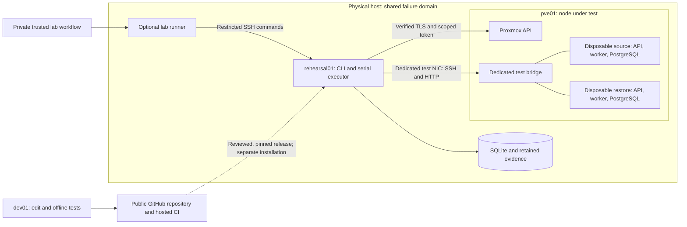

# Proposed architecture

The [prepared-guest slice](prepared-proxmox-exercise.md) now shares the implemented
exercise orchestration, application, verifier and evidence with Docker. It supplies
authenticated SSH/native PostgreSQL transport, guest leases/receipts and read-only
Proxmox admission/task reconciliation. It deliberately requires prepared guests and
does not implement VM provisioning/power/deletion or a controller executor. Its
guest behaviour is offline-tested/simulated, not live-verified. Public hosted
[CI](ci.md) is implemented locally but has no remote run evidence. Neither change
relaxes the unresolved-host-fault risk or current one-running-guest ceiling.

## Implemented local application slice — 13 November 2026

The [local PostgreSQL exercise](local-postgres-exercise.md) implements a separate
dev01 execution transport without the Proxmox adapter or controller state. It uses
Python 3.12, optional Psycopg 3.3.9, standard-library HTTP and pinned PostgreSQL 18.7
with matching native clients. Two internal Docker networks and independent volumes
separate source/restore. A host-side intended manifest precedes seeding; source
writes are quiesced, backup retained, source stopped, target identity checked,
then restored SQL/schema/API data verified before a distinct canary write/read.
The runbook defines monotonic timing boundaries, local evidence, failure handling
and exact ownership cleanup. JSON state snapshots plus append-only intent/events
reuse installation/run/resource UUID and nonce conventions without importing the
VM-9000-specific journal. Recovery execution is never resumed blindly; only
interrupted owned cleanup can continue. The original VM architecture below remains
planned: worker, systemd guest installation, executor, upgrades and VM recovery are
not delivered by the local slice. PostgreSQL 16/FastAPI below are guest proposals,
not dependencies of the local exercise.

**13 November 2026:** [the supplied investigation handoff](investigation-2026-11-13.md)
supersedes the infrastructure status below. Live nested-start validation is blocked
by unresolved host faults and needs a separate explicit operator decision.
Proposed outer CPU allocations are unverified. The local supervised adapter now
adds [request/UPID evidence](supervised-build.md#offline-request-evidence-13-november-2026)
without changing deployed inventory, historical journal rows or cleanup ownership.
The remaining architecture describes the target design and 12 November snapshot.

Status: **target design with inventory and supervised tooling deployed**, 2026-11-12. VM 9000 create/import/resize and stopped-guest isolation are verified. After initial access loss, an operator restart with one vCPU/16 GB allowed read-only reconciliation of the existing stopped guest. A distinct conditional start again lost PVE responsiveness; **the build is halted with a new uncertain UPID and guest boot/stop unverified**. The one-vCPU pattern is provisional, not a demonstrated fix/root cause. One operation/one running guest remains the ceiling; guest 1 vCPU shares PVE's one CPU, with ≥4 GiB PVE RAM reserve and a 2 GiB guest. No link release or uncertain deletion occurred. [Current incident/budgets](supervised-build.md#operator-restart-and-supervised-recovery-attempt) supersede earlier design assumptions; executor/recovery remain future work.

## Components and placement

Use one controller, one durable state store and one active exercise. The first workload is a small Python order service with a separate worker and PostgreSQL, colocated inside each disposable VM.

| Component | Placement and responsibility |
| --- | --- |
| Development checkout | `dev01`: editing, packaging, offline tests and Git; no delivered runtime service |
| Controller | `rehearsal01`, verified `.83`; deployed inventory plus separate supervised journal/tool sidecar. Executor, guest deployment and recovery verifier remain future/unverified work |
| Durable state | SQLite on the controller's local disk; run/operation/resource records and a submission queue |
| Evidence store | Controller disk outside all disposable VMs and preferably outside `pve01`; manifests, dumps, events, timings and reports |
| Proxmox provider | Currently GET-only inventory of configured nodes; resource management is later work |
| Source VM | API, worker and PostgreSQL; deterministic seed and exercise subject |
| Restore VM | A separate fresh VM; isolated before boot; restored database and application verification |
| Optional lab runner | Separate VM, proposed `.84`, outside `pve01`; trusted workflow driver, never the controller or `dev01` |
| Optional PBS | Proposed `.85`, later whole-VM backup exercises; no initial dependency |

Prefer creating `rehearsal01` as a sibling VirtualBox VM of `pve01`. This lets the controller retain evidence and observe loss of the Proxmox node. Putting it inside `pve01` is simpler to bootstrap but loses the observer during node failure, so that placement supports only guest-level exercises. Both placements share physical power, storage and host failure; neither gives physical-host fault tolerance. A second Proxmox node is unnecessary initially.

The user completed this outside-PVE installation. Its `.83/24` address, SSH setup access, unprivileged CLI installation and TLS/API connectivity are now verified. The installed release needs no executor/service or access to `dev01` files. Some SSH connection attempts timed out between successful sessions; that operational issue remains unexplained.

Initial sizing proposals, subject to measurement:

| Resource | Starting budget |
| --- | --- |
| Controller | 1 vCPU, 2 GiB RAM, 20 GiB disk; cap evidence storage at 5 GiB initially |
| First build and each initial workload VM | 1 vCPU, 2 GiB RAM, 12 GiB logical disk; image/filesystem acceptance in the [nested-guest plan](nested-guest.md) |
| Active runs | One; initially one running guest, later at most two workload VMs after isolation/capacity validation; full clones |
| Optional runner | 1 vCPU, 1–2 GiB RAM, approximately 12 GiB disk, outside the PVE disk budget |

SSH inspection now verifies a separate 100 GiB `/dev/sdb`, `rehearsal-vg`, with a **90 GiB `data` thin pool registered as `rehearsal-lvm`** for `images,rootdir` on `pve01`. Use this storage for the planned template and test disks. The original 32 GiB OS disk, approximately 11.8 GiB `local-lvm` and root/local storage remain separate. Pool metadata and its spare are each 1 GiB; the VG has 8 GiB unallocated outside the pool. Capacity checks must examine actual pool data/metadata, node root/staging space and physical-host backing space; none is interchangeable or unlimited.

Retain a pool reserve of max(6 GiB, 20%), now **18 GiB**. The concrete Ubuntu plan supersedes the earlier 6 GiB estimate: three **12 GiB** disks (template, source and restore) total **36 GiB**; add 2 GiB auxiliary allowance, leaving **34 GiB unassigned inside the 90 GiB pool** after the reserve. Charge full logical size even for sparse imports/full clones; linked-clone sharing is not additional capacity. The separate 8 GiB VG free space does not enlarge the pool. Validate real image/auxiliary requirements and fresh data/metadata capacity before admission. User-supplied host evidence confirms both `pve01` dynamically allocated VDIs under `/mnt/ssd` and 636 GB available there: **its initial physical backing-capacity gate is satisfied**. This establishes no disk location for `dev01` or `rehearsal01`. Continue actual-host-space checks as the VDIs and any snapshots grow, preserving the host reserve independently of the pool reserve. See [storage admission and initial concurrency](nested-guest.md#storage-and-concurrency-reconciliation). Never expand storage or delete unrelated resources automatically. Nested-lab timings are educational observations, not realistic performance benchmarks.

The old 11.8 GiB pool no longer determines the test-disk budget. AMD-V, loaded KVM modules, `nested=1`, `/dev/kvm` and KVM API version 12 are verified prerequisites; **successful nested VM boot remains untested**. API inventory does not establish that capability or physical-host headroom.

The diagram shows target boundaries. The controller/read-only API path and dedicated interface configuration are verified; the controller filter is applied, while PVE guest enforcement, workload guests and the optional runner remain outstanding.

## Bootstrap and network isolation

Separate platform preparation from run automation. An operator must create the controller, prepare a trusted base template and pool, allocate an exclusive VMID set, and configure the required bridge/firewall. Those prerequisites may need manual work on the physical host or PVE console. Runtime software never calls host-side VirtualBox tools or requires host SSH/shared folders.

The test path is the operator-configured **`REHEARSAL-TEST` VirtualBox internal network**, connecting controller `enp0s9` to PVE `enp0s16`/`vmbr1`. The [interface/bridge configuration step is complete](environment.md#operator-supplied-dedicated-test-network); end-to-end nested-guest connectivity and firewall enforcement remain unverified. Do not reuse or assume connectivity between `LAB-CTRL`, `LAB-INT`, `lab-storage` and `lab-cluster`.

The [firewall record](firewall-isolation.md) confirms legacy enforcement with actual IPv4/IPv6 hooks, native bridge guard and controller input/forward filtering; all passed platform reboot persistence and fresh management/API checks. The controller's three IPv4 interface-input drops were repeated after reboot. Exact VM 9000 policy and allow tuples were later installed/read back while stopped, with rollback timers canceled after fresh checks. Guest boot/ports/packet enforcement remain unverified after renewed management loss following the new supervised start; link release never occurred. `vmbr0` remains management-only, NAT uplinks unbridged, routing forwarding off and node host-zone filtering off. Inventory credentials remain unchanged. The [first guest plan](nested-guest.md) retains no guest internet route and offline packages delivered over pinned SSH. Guest packet enforcement remains untested. PVE guest-profile/guard persistence was observed across the operator restart; controller tuple reboot persistence is still untested.

PVE's fourth adapter, `enp0s10`, provides dynamic `10.0.5.15/24`, a default route through `10.0.5.2` and DNS through `10.0.5.3`. Its fifth adapter is the separately prepared test connection `enp0s16`. SSH inspection access, including broad passwordless sudo, does not replace scoped API credentials or physical-host administration.

| Path | Proposed mapping and restrictions |
| --- | --- |
| Management | Controller `.83` to PVE `.80:8006`; runner `.84` to a restricted controller SSH account |
| Controller internet | Separate NAT NIC for approved package/artifact delivery; not assumed available until checked |
| Test segment | Configured `10.77.0.0/24`, controller `.1` on `enp0s9`, PVE `vmbr1`/`enp0s16` on `REHEARSAL-TEST`; guest `.10` and restore `.11` remain proposed; connectivity/enforcement unverified |
| Workload egress | No default gateway; no NAT, IP forwarding, management NIC or storage/cluster NIC; IPv6 disabled or explicitly covered by the same deny policy |
| Guest access | Hypervisor firewall permits controller-originated SSH and application HTTP with return traffic; PostgreSQL listens on guest loopback and is reached through an SSH tunnel |

Guest allocations and future runner mappings above remain subject to validated admission/conflict review; supplied and independently verified network facts are distinguished in the environment record. One run uses the operator-owned test segment at a time. The controller must not forward between its test, NAT and management NICs. The PVE test bridge has no management IP or route to storage/cluster links. A dedicated internal segment still requires per-VM rules to prevent source-to-restore traffic and unexpected egress. Configured firewall rules must cover IPv4, IPv6 and relevant layer-2 behaviour; mere lack of a default route is insufficient isolation.

Before cloning, require a validated template with `onboot=0`, no production credentials, no active integrations and NICs absent or disconnected. A clone must remain stopped. Before any first boot, including recovery boot:

1. Confirm resource ownership, the expected stopped state and approved template identity.
2. Remove inherited NICs/mappings, assign fresh MAC/IP/hostname and cloud-init identity, and keep automatic startup disabled.
3. Attach only the approved test bridge; install deny-by-default hypervisor firewall policy with controller access rules.
4. Read back NIC/firewall/cloud-init configuration and prove that the relevant firewall engine is enabled. Missing permissions or uncertain enforcement blocks boot.
5. Enable only that approved NIC, boot, attest guest identity and run connectivity/egress checks. Guest firewall and service binding add defence after boot.

A restored whole-VM image later follows the same sequence while stopped; restored guest firewall settings cannot be the initial isolation boundary. If the dedicated path cannot be prepared, use mocks and inventory only until an alternative is explicitly designed and verified. Do not silently attach test guests to `vmbr0`.

Proxmox cloud-init supports configuring keys and addressing before starting clones. Use its standard supported fields initially rather than assuming a writable snippets store or special image-upload API exists. See the [upstream cloud-init documentation](https://github.com/proxmox/pve-docs/blob/master/qm-cloud-init.adoc).

## Python structure and dependencies

Use Python 3.12 and a versioned wheel in a dedicated runtime venv. Implemented modules are `config`, `cli`, `inventory`, `credentials`, `errors` and the fixture/Proxmox providers. HTTPX is the single direct runtime dependency, with separate runtime/development hash locks. The provider protocol remains read-only. Actual API fields are normalized through an allowlist and credentials are scrubbed; fixtures retain their explicit simulated snapshot schema. `state`, executor, guest deployment, exercises, recovery and resource/task mutations remain later work.

| Choice | Reason and initial scope |
| --- | --- |
| Standard library | `argparse`, `tomllib`, dataclasses/explicit validation, `sqlite3`, `uuid`, `logging`, `hashlib`, monotonic timing and bounded `subprocess` calls avoid unnecessary services |
| HTTPX 0.28.1 | Synchronous verified HTTPS, explicit I/O timeouts and [mock transport](https://www.python-httpx.org/advanced/transports/); one direct dependency instead of a custom HTTP stack |
| pytest and Ruff | Installed only in the project venv for offline behavioural tests and lint/format checks |
| setuptools/build and pinned dependency locks | Conventional wheel packaging; development tools/transitives have a platform-specific hashed lock generated from downloaded wheels with a small stdlib helper; no uv/pip-tools requirement |
| OpenSSH client/server | Guest bootstrap, log collection and encrypted PostgreSQL tunnels; use argument arrays, fixed commands and pinned host keys |
| FastAPI and Uvicorn | A small typed order API with an explicit OpenAPI contract; see [FastAPI documentation](https://fastapi.tiangolo.com/) |
| Psycopg 3 | PostgreSQL access using visible SQL and transactions; see [Psycopg documentation](https://www.psycopg.org/psycopg3/docs/) |
| PostgreSQL 16 server/client tools | Matches the [Ubuntu 24.04 package baseline](https://packages.ubuntu.com/noble/postgresql) and is [supported upstream](https://www.postgresql.org/support/versioning/); pin and record tested patch versions during image preparation, keep them updated, and use matching dump/restore client major |

Do not add Redis/Celery, an ORM, Kubernetes, a web dashboard or a message broker initially. PostgreSQL is also the workload's queue. Install workload services natively under systemd in the guest, with versioned Python release directories. Docker Compose may support explicitly selected local/hosted-CI database tests later; Docker is available but is not required on the controller or on PVE.

Configuration is TOML with a schema version. Offline validation checks node/fixture selection, API URL/TLS/credential-path fields and bounded timeouts/attempts without opening credentials or connecting. Runtime API setup separately loads the CA and protected token. See [the implemented contract](development.md#configuration-contract). Future extensions must validate storage/content support, template IDs, pool, VMID set, test bridge/address mappings, resource ceilings, TTLs, paths and retention. Separate structural validation from capability preflight. Require credential **references**, not inline secrets. Reject insecure TLS, unbounded resource requests, management-network workload mappings and unresolved required values.

`config validate` and explicitly selected `inventory --backend fixture|live` exist with human/JSON output. Live access requires both `--live` and `REHEARSAL_LIVE=1` before credential access. TLS verification, protected token files and bounded GET retries are implemented. Coverage tracks queried/failed/skipped node sections; partial reports return exit 4. Successful queries remain credential-visible, not proof of unfiltered visibility. See [version-specific ACLs and semantics](live-inventory.md). No fallback exists. Default tests prohibit sockets/DNS. `run`, `report` retention and `cleanup` commands are later work.

## Runtime service and durable state

Initially, one `rehearsal-controller.service` consumes the local SQLite queue as an unprivileged `rehearsal` user. Local CLI submissions and the executor share transactional state; only the executor mutates lab resources. A lock/lease prevents duplicate executors or simultaneous sweeps. A systemd timer can invoke expiry reconciliation through the same lock. No controller HTTP service is required.

Use a restrictive umask, systemd credential delivery, `NoNewPrivileges`, a read-only system filesystem and explicit writable state/runtime paths. The controller needs no general sudo rights, Linux capabilities or Docker socket access. Permit only its required outbound API/guest paths; keep the runner-facing forced-command account separate from service administration.

Use `/var/lib/rehearsal/state.sqlite3` and `/var/lib/rehearsal/runs/<run_id>/` on a local filesystem. Use SQLite transactions, foreign keys, durable synchronisation, schema migrations and short write locks; never put the database on a network share. Back it up consistently with SQLite's backup mechanism together with the installation identity and evidence index. Recovery of lost controller state must not enable speculative deletion of VMs.

Persist these records before relying on them:

| Record | Essential fields |
| --- | --- |
| Installation | Persistent random installation UUID, schema version, allowed cluster/node/pool/VMID scope |
| Run | UUIDv4 run ID, exercise and parameters, submission key, code revision, configuration digest, UTC creation/expiry, phase/outcome/cleanup status, lease owner/heartbeat |
| Operation | Unique operation ID, run/step, request intent and request digest, attempt, target identifiers, deadline, response/ambiguity state, UPID/node and observed status |
| Resource | Installation/run IDs, role, VMID/node/pool, random generation nonce, ownership metadata, expected volumes/NICs and deletion state |
| Evidence | Artifact path, media type, size, checksum, timestamp, provenance and redaction status |

Never persist raw token headers or secret-bearing requests. A retry of a CLI/runner submission uses the same submission key and returns the existing run. A new exercise uses a new run ID. The installation UUID survives service restarts.

Phases normally advance through `QUEUED → PREFLIGHT → PROVISIONING → DEPLOYING → SEEDING → EXERCISING → VERIFYING → COLLECTING → CLEANING → FINISHED`. Exercises can revisit provisioning for a restore target, recorded as distinct steps. Keep outcome (`passed`, `failed`, `errored`, `cancelled`, initially unset) separate from phase and cleanup (`not_started`, `pending`, `complete`, `failed`). Failures and cancellations still collect evidence and clean up. Only mark `FINISHED` after the report is durable and cleanup is complete. An uncertain operation enters `NEEDS_RECONCILIATION`; failed/unavailable cleanup stays `CLEANUP_PENDING` with a durable reason. Overall command success requires successful checks, complete evidence and complete cleanup.

On startup, recover unfinished runs from the journal, reconcile operations/resources and resume from a verified checkpoint. Do not rerun an entire exercise blindly. Steps involving writes must have idempotency keys or a reconciliation rule. Cancellation is a durable request observed at safe boundaries, not a promise that terminating a process cancels an already accepted PVE task.

## Proxmox tasks, timeouts and ambiguous outcomes

Live inventory uses the supported read-only version, node, storage, QEMU and network endpoints, now verified with the scoped token on PVE 9.2.2. Bridge visibility additionally needs the documented `SDN.Audit` scope. Version/capability discovery must still precede any later mutation; current audit credentials cannot provision resources.

For asynchronous mutations, commit operation intent **before** sending the request; persist the returned UPID and its node immediately. Poll `/nodes/{node}/tasks/{upid}/status`, collect `/log`, and require a stopped task with successful exit status plus the intended resource postcondition. An HTTP success or UPID alone is insufficient. The [upstream task API implementation](https://github.com/proxmox/pve-manager/blob/master/PVE/API2/Tasks.pm) documents task visibility and status/log operations.

Initial configurable limits: 3-second connection timeout, 15-second ordinary request timeout, three total attempts for retryable reads with capped exponential backoff/jitter, 10-minute clone/boot deadlines and a 45-minute exercise deadline. Long operations are polled; do not hold one HTTP call open indefinitely. Authentication/permission failures and TLS failures are not retryable. Distinguish transport, TLS, HTTP authentication, authorisation, task failure and guest-readiness failure in reports.

Provisioning must handle a request that succeeded on PVE while its response was lost:

1. Under the controller lock, reserve an ID from the operator-assigned exclusive set; inventory confirms it is unused. PVE's next-ID suggestion is not a reservation.
2. Commit the intent, deterministic unique name and pool, resource nonce and desired configuration. Supply ownership-identifying fields atomically with creation wherever the API supports them; add full markers while the clone is stopped.
3. If delivery or response is uncertain, mark the operation ambiguous. Do not choose a new ID or resubmit a clone automatically.
4. Query the intended ID, current/recent tasks and ownership evidence. Correlate the initiating identity, timing, task target and expected clone origin. Reconcile an attributable existing task/VM; inspect its completion and volumes before progressing.
5. If provenance is incomplete, including a crash between cloning and marking, quarantine the intent/resource for operator reconciliation. A name/pool match alone cannot authorise adoption or deletion. Even an absent VM can have a task still running; absence alone does not authorise another creation.

The same rule applies to starts, stops, restore operations and deletes. Retry a mutation only after authoritative reconciliation establishes its prior effect and that repeating it is safe. On deadline expiry retain task/intent state and stop new mutations; the server task may still run. Do not delete its disks or clear its locks while it is active. A failed task may leave partial resources that need the same ownership checks.

## Ownership and interrupted-run cleanup

Use an operator-created `rehearsal` pool plus explicit installation/run/resource markers (tags and structured description metadata where supported). Exact IDs and a random generation nonce in durable state prevent mistaking a reused VMID for the old VM. Pools, names, VMID allocations and expiries are safeguards, not standalone ownership proof or security boundaries.

Cleanup requires all of: matching installation UUID, run UUID, generation nonce and recorded live resource identity; membership in the allowed pool/node/VMID set; and absence from the protected set of controller/template/unrelated IDs. Recheck immediately before destructive calls. Delete only recorded owned disks, cloud-init volumes and other dependencies; never sweep arbitrary unattached volumes, broad storage contents or resources selected only by prefix. Shared networks, templates, pools, ISOs and manually prepared infrastructure are not run-owned.

Every run gets an expiry (proposed default six hours) and a renewable executor heartbeat (for example every 30 seconds, stale after two minutes). A sweep approximately every 15 minutes acquires the same lock, checks expiry, stale lease and active tasks, then reconciles and cleans confirmed owned resources. Expiry alone never overrides a healthy lease or an active/unresolved task. If PVE is unavailable, preserve `CLEANUP_PENDING`, report the reason and retry on a later bounded sweep. Flag overdue runs even if a healthy lease prevents deletion. Debug holds must be explicit, bounded and capacity checked.

An orphan whose metadata matches a known run can be reconciled with the journal. Metadata without a trustworthy journal, mismatched markers, or missing creation provenance requires operator review. State loss means fail closed. Cleanup retries and outcomes append evidence; they do not erase the original failure. Exercise failure and cleanup failure remain independently visible.

## Workload and independent checks

Build a small order service with `orders`, `order_items`, `jobs` and `receipts` tables, foreign keys, uniqueness constraints, integer minor-unit amounts and a schema-version table. Use fixed seed UUIDs, quantities, prices and business timestamps. Seed approximately 100 small orders initially; maintain a separate fixture/generator version and canonical expected results on the controller.

`POST /orders` accepts an idempotency key and transactionally creates the order, items and a job. `GET /orders/{id}` returns order state; `/version` identifies build/schema compatibility. A separate systemd worker polls PostgreSQL, claims jobs transactionally, computes a deterministic receipt and atomically records completion. Unique receipt/job constraints make retry after worker restart safe. Small numbered, checksummed SQL migrations suffice initially; record their application and compatibility range.

| Check | Meaning |
| --- | --- |
| HTTP liveness | `/health/live` proves only that the API process can respond |
| Database readiness | `/health/ready` proves a simple DB query/migration compatibility, not worker progress |
| Functional HTTP | Create/read/list expected orders; invalid input and repeated idempotency keys behave correctly |
| Independent SQL | Controller uses a separate read-only verification role over SSH to inspect exact records, constraints, aggregates and job/receipt relations |
| Worker progress | Submit a fresh canary and require a receipt/status transition by a deadline; compare queue age/completion with SQL, not only a heartbeat |

A stalled worker must produce a failed exercise while HTTP liveness can remain 200. Verify receipt contents and exactly-once observable effects, not just queue size or a process PID. The verifier runs on the controller and does not import application business logic or trust the application's own recovery assertions. Use fixed expected fixtures, separately implemented canonicalisation and deliberate missing/changed/extra-row tests to demonstrate that it detects corruption.

For upgrades, deploy immutable v1/v2 release artifacts by digest, switch the guest's active release and restart services. Begin with additive, backward-compatible schema changes. Verify old records and new HTTP/worker behaviour, then rehearse reverting the code release. Record the schema compatibility decision explicitly. An irreversible migration requires a separate backup/restore recovery path; do not claim that switching the Python package reverses data/schema changes.

## First recovery exercise: logical database restore

The initial exercise is `postgres-logical-restore`. It is not VM backup or PITR.

1. Preflight capacity, identities and isolation. Prepare the stopped source, apply isolation, boot and deploy the pinned application/schema.
2. Generate and retain a manifest **on the controller before seeding**. Include seed/fixture version, exact expected IDs and domain values, row counts, per-record canonical hashes, totals and expected receipt/job relations. Retain its checksum outside the source. Operational timestamps excluded from deterministic hashes need separate validity checks.
3. Seed through the HTTP contract, wait for the expected worker completions, and verify source data against that manifest through HTTP and independent SQL. Reject missing, extra, changed, duplicate or inconsistent records.
4. Stop writers: block new writes and stop/drain the worker; confirm no in-flight transactions or external writers. Record the last acknowledged seed write and the frozen dataset boundary. This avoids a manifest/backup consistency race in the first exercise.
5. Run matching-major `pg_dump -Fc` from the controller through a verified SSH tunnel. Persist stderr, exit status, tool/server versions, start/end times, size and SHA-256; write to a temporary file, then atomically publish a completed archive. Inspect its contents list, but do not treat a successful listing or checksum as successful recovery. PostgreSQL logical dumps represent a consistent database snapshot; a single-database dump does not contain cluster-global roles. See [pg_dump](https://www.postgresql.org/docs/16/app-pgdump.html).
6. Confirm the manifest, archive and logs are readable on the controller. Power off the source and remove its tunnel; record source unavailability. If needed for storage, delete that proven owned source and record the deletion before allocating a distinct target VMID.
7. Start the recovery timer **before target provisioning**. Create a new target from the prepared template, enforce isolation while stopped, then boot it. Recreate database roles/permissions and an empty database from versioned setup; use fresh credentials. Restore with `pg_restore --exit-on-error --single-transaction --no-owner --no-privileges` into the named empty database. Reapply intended grants. One transaction is appropriate for this tiny dataset; no parallel restore initially. See [pg_restore](https://www.postgresql.org/docs/16/app-pgrestore.html).
8. Keep API writes and the worker disabled while checking restored data. First compare the recovered canonical records and relations with the retained manifest using independent SQL, then start the pinned application and verify HTTP reads. Verify schema, sequences and constraints, not just row counts. The source must remain unavailable and endpoint/VM identity must prove checks reached the target.
9. Enable the target worker and writes; create a new, separate canary order and require its correct receipt by a deadline. Preserve the pre-canary manifest comparison. Stop recovery timing only when all declared data, HTTP and worker checks pass.
10. Collect evidence, write the report and clean owned resources. An otherwise successful restore with failed verification is a failed recovery; failed cleanup also prevents overall success.

Roles for seeding/application, read-only verification, backup and target setup are separate and limited to the synthetic database. Use protected passfiles/credential files rather than passwords in command arguments. PostgreSQL stays on guest loopback; SSH host identity must be verified. A template with a working guest agent can expose the new guest's **public** SSH host key through the authenticated PVE API for pinning against the correct marked VM; validate that capability/permission during provisioning. Never disable host-key checking. The agent is a bootstrap transport, not the independent data verifier.

### Recovery timing and claims

Report separate durations for backup, source shutdown, target provision/boot, restore, data verification, application readiness, worker canary and cleanup. Use controller monotonic time for durations and UTC timestamps for chronology. Record clock synchronisation quality; after a controller restart, mark any discontinuous timing as incomplete rather than inventing a monotonic interval.

The initial primary metric is **observed recovery duration from recovery start to verified usable target**, including target allocation/boot. Also record source-unavailability-to-usable duration; a delay before recovery start must not vanish from that measurement. Neither metric alone proves a service RTO. To assess an RTO, define the objective, failure/start condition, detection/operator delays, included provisioning steps and full service acceptance criteria in advance, then compare repeated measured recoveries with that objective under stated conditions.

For the frozen dataset, report exactly which acknowledged records were recovered and that no expected seeded records were lost. Do not label this `RPO = 0` for a running service. A measured RPO needs an independently retained ordered write/acknowledgement ledger, backup consistency boundary, defined failure time, recovered commit/record boundary and explicit accounting of any missing acknowledged writes, including evidence when that set is empty. Concurrent-write tests later must align the verification manifest with a controlled/exported snapshot or equivalent commit ledger. WAL archiving/base backups and PITR are separate later designs; `pg_dump` alone cannot demonstrate continuous point-in-time recovery.

### Separate VM backup and PBS exercises

Database-native restore rebuilds database objects inside an already prepared OS. A PVE whole-VM backup covers VM configuration and included disks, so its recovery also tests the guest OS, service configuration and identities. Invoke PVE backup/restore through the API, retain its UPIDs and provision a stopped restore target before changing NICs and booting. Select and record a consistency strategy; filesystem freeze alone is not independent proof of application consistency. PVE can store backups as files or in PBS, as described in its [backup documentation](https://github.com/proxmox/pve-docs/blob/master/vzdump.adoc).

PBS adds a separate backup service/datastore with its own capacity, credentials, retention and availability requirements. It changes backup storage and management, not the requirement to verify recovered application data. A snapshot remaining on the source storage is not an independent recovery copy. None of these facilities is required for the first logical database exercise; reuse its external manifest and verifier when whole-VM recovery is added.

## Evidence, retention and credential boundaries

Each run retains `manifest.json`, a redacted configuration snapshot, operation/UPID journal, JSONL events, guest/service logs, backup metadata, verification diffs, step timings, `report.json` and a readable report. Include installation/run IDs, exercise/verifier schema versions, code revision, artifact/image hashes, VMIDs, topology, timestamps, check status, errors and cleanup disposition. Store evidence incrementally so controller or guest failure does not lose the entire report. Hash artifact files and an evidence index; local checksums detect accidental changes, not malicious tampering by a controller administrator.

Proposed initial retention: reports/manifests/sanitised logs for 30 days; synthetic dumps for seven days, all bounded by quota. Preserve small failure summaries when large artifacts expire. Check controller free space before starting and before backup; fail safely if evidence cannot be persisted. Keep SQLite resource records until cleanup is resolved, regardless of artifact retention. Consistently copy controller state and selected reports to a separately chosen backup destination later. Controller disk and CI artifacts survive disposable VMs, but do not constitute physical-host disaster protection.

Use dedicated PVE service identities and privilege-separated expiring API tokens, with different read-only inventory and mutation credentials. Effective token rights are the intersection of user and token rights, as described in [Proxmox user management](https://github.com/proxmox/pve-docs/blob/master/pveum.adoc). Store credentials in protected runtime files/systemd credentials; do not place them in SQLite, Git, process arguments or artifact bundles.

Build and test an endpoint-to-permission matrix against the installed API before granting rights. Candidate scopes are node/storage/VM audit for inventory, clone on the chosen template, allocate/configure/power/delete on assigned disposable VM IDs/pool, allocation on the chosen storage, and the minimum network/firewall/guest-agent rights needed. Confirm whether the installed version needs separate bridge/SDN permissions. Do not assume pool membership alone constrains every operation. Do not grant root credentials, host shell access, unrestricted node administration or broad storage deletion. Create bridges/templates/pools separately rather than giving the controller platform-administration rights. An ACL denial should identify the missing operation without broadening privileges automatically.

TLS verification is mandatory, using a trusted CA bundle and a certificate matching the configured DNS name or IP SAN. Obtain/verify trust through an operator-controlled channel. Do not log authorization headers, passfiles, private keys, DSNs with passwords or cloud-init secrets. Use only generated synthetic data and per-run guest credentials. Strip secret-bearing content before durable logging and again before export; public reports require an explicit sanitised export format.

## GitHub Actions trust model

Ordinary CI belongs to the public repository on **GitHub-hosted runners**, triggered by pull requests and pushes to `main`. It runs package/configuration tests, mocked provider/task tests and lint without lab credentials or network access to the lab. Later, explicitly selected PostgreSQL service-container tests can run there as a separate job without Proxmox access. Use minimal `GITHUB_TOKEN` permissions, reviewed workflow dependencies pinned to full commit SHAs, and immutable application artifacts.

For lab access, prefer an optional **private lab-workflows repository** with a runner registered only to that private repository. GitHub warns against self-hosted runners on public repositories because fork PRs can execute dangerous code; see [adding self-hosted runners](https://docs.github.com/en/actions/how-tos/manage-runners/self-hosted-runners/add-runners). The private repository is proposed, not created. Until it is arranged, trusted manual controller runs remain the live integration path. Labels and a job-level condition in a public workflow are not sufficient isolation.

Place that runner on the optional `.84` VM outside `pve01`, with outbound GitHub HTTPS and access only to restricted controller SSH commands. It has no PVE token, controller state access, Docker socket on the controller, general controller shell or physical-host access. The controller retains lab credentials. A forced-command account accepts only structured, validated inventory/submit/status/report/cancel requests for installed exercise versions; no arbitrary shell, checkout ref or command field. Use a pinned SSH host key and narrowly scoped runner credential. Rebuild or reset the runner between jobs where practical; outbound connectivity from this VM must be checked first.

Initial trusted lab trigger: maintainer `workflow_dispatch` from the private repository's reviewed default branch. Allow only an approved immutable public `main` commit/release, verified through trusted metadata, and allowlisted exercise inputs. The controller executes an already installed, separately reviewed release; CI must not replace its installed code or forward arbitrary PR code. Add schedules only after cleanup and capacity handling are proven. Do not use PR triggers, `pull_request_target`, or `workflow_run` consuming untrusted code/artifacts for lab execution. GitHub's [secure-use guidance](https://docs.github.com/en/actions/reference/security/secure-use) explains the risks of privileged workflows and untrusted checkout.

Use a fixed lab concurrency group such as `rehearsal-pve01` with `cancel-in-progress: false` across all lab exercises; the controller's lease remains authoritative across manual and CI submissions. GitHub [concurrency controls](https://docs.github.com/en/actions/how-tos/write-workflows/choose-when-workflows-run/control-workflow-concurrency) serialize matching jobs, but are not the lab's durable queue. Apply job timeouts and idempotent submission keys based on repository/run ID/attempt. Workflow cancellation requests controller cancellation; controller TTL reconciliation handles a lost runner.

Always attempt to retrieve sanitised reports after success or failure, using an `always()` collection step and a bounded artifact retention (initially 14 days). Runner loss can prevent upload, so the controller remains the authoritative evidence store. Do not upload dumps, credentials, raw guest configuration or unsanitised logs. Ordinary public CI artifacts and private lab evidence stay separate; publishing a lab report is an explicit sanitised export. Review repository/environment protections and available account features during milestone 5; do not assume environment approval alone protects a machine with standing lab access.
