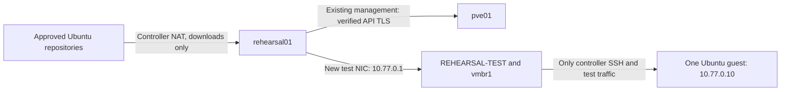

# First nested Ubuntu guest and template plan

Prepared **2026-11-12**, updated after operator recovery. **Only VM 9000 build/test/stop is authorized**, excluding identity cleaning, conversion and clone 9100. Creation/import/resize and stopped-guest rules succeeded. After PVE access loss, the operator restarted with one vCPU/16 GB; read-only reconciliation established the existing stopped guest and resolved the old operation's current effect, while preserving its unavailable historical result. **One distinct new start again lost PVE access; actual boot and stop remain unverified.** The attempt is halted with the new UPID retained. No create/import repetition, link release or uncertain deletion occurred. [Current incident/budgets](supervised-build.md#operator-restart-and-supervised-recovery-attempt) supersede preparation status. Inventory identity/ACLs/release remain unchanged.

Subsequent [PVE activation and platform reboot checks](firewall-isolation.md) passed. Exact VM 9000 policy/allow tuples were later installed while stopped, with checks and rollback-timer cancellation before start. Platform/configuration checks do not establish guest isolation. Current PVE state is unreadable; await operator console evidence and reconcile the exact task before further VM mutations.

## Outcome and order

Prove that one small, owned Ubuntu guest actually boots inside `pve01`, can be reached securely from `rehearsal01`, and executes a command there. Prepare it as a reusable template only after those checks pass. Then boot and delete one full validation clone, serially, to prove that the cleaned template generates a fresh identity. No application/database or recovery exercise is included yet.

The first temporary guest becomes the template at the same VMID: conversion does not require a second copy of its root disk. The validation clone is temporary; the validated template is retained and protected from run cleanup. A passing start task, CPU flags or a responsive API alone cannot pass this milestone.

The current task authorizes live provisioning of **only 9000** after its remaining admission gates. The separate supervised tool provides the offline-tested journal/reconciliation/cleanup/capacity slice. A daemon is not required. Broader template/clone stages below remain plans requiring separate authorization.

## Read-only findings that constrain the plan

The following bounded, batch-mode, existing-host-key-verified SSH snapshot on 12 November **predates operator network preparation**. Its missing-test-interface findings are historical. The operator has since completed `REHEARSAL-TEST`, PVE `vmbr1`/`enp0s16` and controller `enp0s9`/`10.77.0.1`; subsequent SSH corroborated Linux configuration. See the [supplied findings](environment.md#operator-supplied-dedicated-test-network) and [effective firewall inspection/implementation plan](firewall-isolation.md). Guest connectivity and enforcement remain unverified.

| Finding | Consequence |
| --- | --- |
| `pve-manager` 9.2.2, `vmbr0` `192.168.56.80/24`, sole bridge port `nic0` | This is the management/host-only bridge, not a prepared test network |
| `enp0s10` `10.0.5.15/24`, default via `10.0.5.2`, outside every bridge | PVE's own NAT uplink does not give a nested guest an uplink |
| `nic1` `10.20.20.80/24`, `nic2` `10.30.30.80/24`, neither bridged | Keep storage/cluster links out of the guest design |
| IPv4 and IPv6 forwarding both `0`; empty nftables ruleset; no NAT table in `iptables-save` | No inspected PVE routing/NAT path for guest internet access |
| `pve-firewall status`: `disabled/running`; both firewall services reported active; cluster/node options had no explicit settings | A running process is not evidence of enforced guest isolation; operator preparation is a hard gate |
| `interfaces.d` contains only an empty `sdn` file; no dedicated test bridge | Do not silently substitute `vmbr0` |
| Controller has only NAT `enp0s3` and management `enp0s8`; forwarding both `0` | It needs a separately prepared test interface, not an assumed existing path |
| No QEMU VMs and no resource pools; `rehearsal-lvm` active, 90 GiB, data 0%, metadata 1.61% | IDs/pool below are proposals, not reservations; recheck at admission |

No guest packet path, firewall enforcement, physical-host network setting or guest egress was tested. `sysctl` was absent from the normal remote PATH; the forwarding values were read directly from `/proc/sys/net`. See [the dated environment record](environment.md#nested-guest-preparation-inspection).

## Guest and image specification

| Setting | Proposed value |
| --- | --- |
| Node / disk storage | `pve01` / **`rehearsal-lvm`** exclusively |
| Candidate VMID / name | **9000**, `rehearsal-noble-build`; becomes `rehearsal-noble-20261017-v1` after validation |
| Validation clone | **9100**, `rehearsal-noble-check`; delete after checks |
| Later source / restore IDs | 9100 / 9101, only after separate recovery authorization; do not allocate 9101 now |
| Resource pool | Operator-prepared `rehearsal`; pool membership supplements, but never proves, ownership |
| CPU | One socket, one core, `cpu=host`, KVM enabled; no software-emulation fallback; single-node image, no migration promise |
| Memory | **2048 MiB**, `balloon=0`; template stopped after preparation |
| Root disk | **12 GiB logical**, raw thin LV, `scsi0`, `scsihw=virtio-scsi-pci`, `discard=on`; no snapshot/EFI/TPM disks |
| Firmware / display | SeaBIOS, default i440fx machine type recorded in evidence; serial socket `serial0`, display `serial0`, Linux OS type |
| Boot / startup | `boot=order=scsi0`, `onboot=0`, create with `start=0`; no HA/startup schedule |
| Cloud-init drive | `ide2=rehearsal-lvm:cloudinit`, `citype=nocloud` |
| NIC | One VirtIO NIC, fresh recorded MAC, approved **`vmbr1`**, `firewall=1`; initially `link_down=1` |
| Agent | Enable QEMU guest-agent channel; install/verify guest package separately, not assumed in the image |

Use Canonical's **Ubuntu Server 24.04 LTS amd64 cloud image**, released build **20261017**, rather than a moving `current` URL or installer ISO:

```text
https://cloud-images.ubuntu.com/releases/noble/release-20261017/
ubuntu-24.04-server-cloudimg-amd64.img
ubuntu-24.04-server-cloudimg-amd64.manifest
SHA256SUMS
SHA256SUMS.gpg
```

The [official build directory](https://cloud-images.ubuntu.com/releases/noble/release-20261017/) lists a roughly 593 MiB image. Its [published SHA-256 entry](https://cloud-images.ubuntu.com/releases/noble/release-20261017/SHA256SUMS) is `04e8f2461a16a44e78a370284471f29616cdd9baf1893df25807b71f985b6c94`. The original preparation read published metadata only. During the authorized supervised attempt, **signature, digest, downloaded bytes and actual format/virtual size were verified**; see the [input evidence](supervised-build.md#verified-image-and-agent-bundle). Pin these inputs in the future build record; a missing/changed artifact or signature is a blocker, not permission to substitute another build silently.

Repeatable image preparation on the controller/operator workstation (steps 1–4 completed, using bounded RAM staging on PVE; import/resize pending):

1. Download the four files with verified HTTPS and bounded requests. Retain them outside Git, under a unique build directory. Use the Ubuntu-distributed cloud-image keyring, whose provenance/fingerprint is checked independently; do not trust a key solely because it accompanied the download. The keyring exists on `dev01`; it was not found at the checked path on PVE. Follow [Canonical's signature/checksum procedure](https://ubuntu.com/docs/public-images/public-images-how-to/verify-image-checksum/) and [keyring guidance](https://ubuntu.com/docs/public-images/public-images-reference/artifacts/).
2. Use `gpgv --keyring /usr/share/keyrings/ubuntu-cloudimage-keyring.gpg SHA256SUMS.gpg SHA256SUMS`; require a valid expected signing key. Check the exact image and manifest entries against that authenticated checksum list, including the pinned image digest above. Record the signer, URL/build, hashes and verification exit statuses.
3. Inspect with `qemu-img info --output=json` and `qemu-img check`. Require qcow2, no external backing file, and virtual size at most 12 GiB. Never shrink a larger image to meet the budget. A format/size mismatch requires revising the plan. No inspection utility is installed in this preparation task.
4. Transfer through verified SSH to an operator-owned, bounded staging directory such as `/var/lib/vz/rehearsal-staging/<build-id>`; recheck hashes on PVE. Allow **2 GiB staging on the OS filesystem**, separately from the pool allowance, retaining at least **4 GiB OS free**. No unpacked raw image or repeated downloads on the small root disk.
5. Create stopped VM 9000 through the future provisioning API operation, with ownership metadata in the initial request. The installed storage API refuses arbitrary filesystem `import-from` paths unless the caller is `root@pam`. Therefore the **one-time trusted operator** invokes the local asynchronous config API through `pvesh` over existing verified SSH to import that staged file into `scsi0` on `rehearsal-lvm`; capture its UPID and resulting volume identity. This is template bootstrap, not a controller shell dependency. Do not give the mutation token root credentials or `Sys.Modify` to work around it. No content-type change to `local` or `rehearsal-lvm` is proposed. Later runtime provisioning clones the prepared template through HTTPS only.
6. Resize `scsi0` through the API to exactly 12 GiB, then verify its LV and the guest filesystem after boot. Retain the original image/digest on the controller; remove only this attempt's PVE staging copy after import/evidence publication.

The selected [official package manifest](https://cloud-images.ubuntu.com/releases/noble/release-20261017/ubuntu-24.04-server-cloudimg-amd64.manifest) contains OpenSSH server and cloud-init but **does not list `qemu-guest-agent`**. Plan its installation instead of treating the agent-enabled VM option as readiness.

## Connectivity, packages and restore isolation

Network interface/bridge configuration is complete on the [operator-supplied findings](environment.md#operator-supplied-dedicated-test-network), with Linux state corroborated. Guest addresses below remain future allocations subject to validated admission:

| Path | Configuration / remaining gate |
| --- | --- |
| Management/API | Existing controller `.83` to PVE `.80:8006`, existing CA and inventory access unchanged |
| Test layer 2 | Operator-configured **`REHEARSAL-TEST`**; PVE adapter 5 Intel 82540EM/cable connected/allow-vms; controller adapter 3 Intel 82540EM/cable connected/deny; nested-MAC path untested |
| PVE test bridge | **`vmbr1`**, solely **`enp0s16`** / `08:00:27:0f:b7:12`, UP/forwarding, no IP; host IPv6 disabled; no gateway/NAT/management/storage/cluster port |
| Controller test address | **`enp0s9`** / `08:00:27:79:e0:74`, **`10.77.0.1/24`**, no gateway, DHCP/RA/link-local disabled; management/NAT routes intact |
| First guest / validation clone | **`10.77.0.10/24`**, sequential use only after prior guest is stopped; later restore `.11/24` |
| Guest routing/DNS | No default IPv4/IPv6 route; no external DNS dependency; PVE cloud-init `nameserver=127.0.0.1` avoids inheriting node NAT DNS; no resolver service is required for this offline guest |
| Controller egress | Its own existing NAT path is used for approved artifact/package acquisition; it must not route packets from the test network |

The operator has arranged those NICs/network separately; the application never uses host SSH, shared folders or `VBoxManage`. VirtualBox's **Allow VMs** setting on the PVE test adapter is operator-supplied, not independently inspected. Actual nested-MAC passage remains unverified until a separately authorized guest test; do not loosen the management adapter. See the [official VirtualBox 7.2 manual](https://download.virtualbox.org/virtualbox/7.2.10/UserManual.pdf); installed host version 7.2.22 remains user-supplied.



There is **no guest internet route** in this proposal. PVE's `10.0.5.2` gateway is not on the guest subnet; adding it to cloud-init would not solve routing. Do not enable PVE/controller forwarding, masquerading, bridge the NAT NIC, or attach a second management NIC to the guest. If direct guest apt egress is desired later, that requires a separate gateway/proxy and reviewed policy, not a change hidden in this bootstrap.

For the agent, prepare a bounded, versioned `.deb` bundle on an authorized Ubuntu 24.04 amd64 acquisition machine using authenticated APT metadata. Resolve the dependency closure **against this image's manifest**, not merely what happens to be installed on `dev01`/controller. Save package versions, package SHA-256 values and signed-index provenance; prove the bundle is installable without downloads. After SSH is pinned, transfer over that channel and install without network fetching (`apt-get --no-download` using staged local packages or an ordered `dpkg` installation), then enable/check `qemu-guest-agent` inside the guest. Missing dependencies fail visibly; never repair by adding a guest uplink. Do not run a general package upgrade in cloud-init. Later template refreshes deliberately rebuild and retest these inputs.

Before boot/releasing `link_down`, read back the active [platform firewall](firewall-isolation.md#successful-pve-only-activation) and install/verify the stopped owned guest's exact per-VM/NIC policy, bridge port/MAC/IP/ARP pair and controller tuple. Node host-zone filtering stays off to preserve management. For each guest use default-deny inbound/outbound, controller-originated TCP 22/ping and return traffic, no DHCP/RA and no IPv6 frames. No source-to-restore, guest-to-management, storage/cluster or internet access is allowed. Guest settings add defense after boot; they are not the initial boundary. Inspect compiled/applied rules and later counters/negative checks. No per-VM profile or guest tuple exists yet; active platform hooks and the earlier controller input drops do not prove guest connectivity/isolation.

Future restore VMs remain stopped while inherited NICs, MAC/IP, identities, integrations and firewall policy are replaced/read back. Permit only controller access on the test bridge. Use `.11` and a distinct MAC/key/VMID; retain peer-deny policy even on the same layer-2 segment. Do not boot a restored management NIC and detach it afterward. Enforced layer-2/IPv6 isolation and negative peer tests are prerequisites to running source and restore together.

## Cloud-init, guest credentials and host identity

Proposed standard PVE fields for the stopped build guest:

```text
name=rehearsal-noble-build
citype=nocloud
ciuser=rehearsalguest
ciupgrade=0
sshkeys=<only the dedicated build public key, API-encoded>
ipconfig0=ip=10.77.0.10/24,ip6=manual
nameserver=127.0.0.1
onboot=0
```

Omit `cipassword`; require a locked password, disabled password SSH/root SSH and the expected sudo policy in the generated cloud-init data and effective guest sshd configuration. Ubuntu's bootstrap user may need guest-local sudo for agent installation and cleaning, never PVE/controller sudo. Read back generated cloud-init through the authenticated API before boot and verify its exact semantics against this image. Standard fields do not express arbitrary user-data hardening; missing required settings block promotion rather than assuming they took effect. No snippets-capable storage or custom snippets are assumed. [Proxmox documents](https://github.com/proxmox/pve-docs/blob/master/qm-cloud-init.adoc) the SCSI/cloud-init/serial configuration and SSH-key fields.

Generate a new **Ed25519 build key on `rehearsal01` as `rehearsal`**, later under `/var/lib/rehearsal/keys/<build-id>/`, directory 0700/private key 0600. Inject only its public key; never copy the developer's private key, use agent forwarding or obtain keys from GitHub/Launchpad. A separate fresh key is used for validation clone 9100, and later keys are per run. Retire the build key after promotion and completed cleanup; unresolved attempts retain only the narrowly scoped protected material needed for reconciliation.

The agent is not initially installed, so host-key bootstrap must not depend on it. Use the authenticated PVE serial-console path to capture Ubuntu's first-boot **public SSH host-key fingerprint**, bound to VMID, ownership nonce, fresh boot and console evidence. Verify that this image emits it; otherwise stop and arrange an authenticated console-assisted public-key read rather than accepting an unknown host. Console access tickets are secrets: never include them in the retained console transcript/report. Obtain the public key over the test link, compare its SHA-256 fingerprint to that trusted evidence, and write a per-resource `known_hosts` file only on a match. `ssh-keyscan` alone is not a trust source. Use `StrictHostKeyChecking=yes`, `IdentitiesOnly=yes`, `BatchMode=yes`, `UpdateHostKeys=no`, no forwarding and bounded connect/command timeouts. Never use accept-new or disable host-key checking.

After authenticated SSH installs the agent, audit-only agent ping/interface/hostname queries corroborate guest state. No guest-agent arbitrary exec or file-read privilege is necessary for this initial host-key bootstrap. The actual remote command evidence comes from SSH.

## Execution, evidence and promotion gates

These are future supervised stages. Before each mutation persist intent; poll returned UPIDs to terminal success and verify the postcondition. Example budgets: connect 3 seconds/read 15 seconds, import/clone 10 minutes, boot/cloud-init 10 minutes, SSH command 30 seconds, whole build 45 minutes. Bounded transient retries apply to reads only. A timed-out mutation enters reconciliation; never allocate another VMID or repeat import/clone because its response was lost.

1. **Admission:** complete the [controller reboot validation](controller-reboot.md); confirm dedicated network/firewall, host backing-space evidence, fresh root/pool/metadata/RAM checks, pool existence and exclusive free VMID 9000/9100. Reject a busy ID; do not choose the next available one silently. Reserve them in durable state under one operator lock. Candidate 9000 uses a six-hour expiry/lease; shared platform resources are not run-owned.
2. **Stopped creation/import:** record installation UUID, build/run UUID, random resource nonce, node/pool/VMID, expected image/config digest and volume ledger. Put matching structured description/tags in the create request atomically, with `start=0`. Capture create/import/resize UPIDs. Reconcile any ownership gap. Record exact root/cloud-init volumes; all disks must be on `rehearsal-lvm`.
3. **Pre-boot isolation:** record stopped state, sole approved test NIC/MAC, no gateway, `onboot=0`, firewall enforcement and generated cloud-init. Remove unintended inherited mappings. Enable only the approved NIC after readback. Any uncertain enforcement or ownership blocks start.
4. **Actual boot:** start once, retain UPID/log/exit status, then capture serial output showing Ubuntu/kernel boot, VM identity and host-key fingerprint. Pin SSH as above. A VM in `running` state without guest evidence fails readiness.
5. **Remote verification:** from `rehearsal01` as `rehearsal`, SSH as `rehearsalguest` and collect `id`, hostname, `/etc/os-release`, kernel, boot ID, `systemd-detect-virt`, `cloud-init status --wait --long`, addresses/routes, disk/filesystem sizes/free space and a controller-generated nonce echoed by the guest. Require Ubuntu 24.04, expected VM identity, successful cloud-init and filesystem growth to the intended size. Treat cloud-init degraded/error status explicitly, not as success. Record that KVM was configured without emulation fallback and guest boot actually completed.
6. **Network/package checks:** verify bidirectional controller/test communication, then deliver/install the verified offline agent bundle and require agent ping plus expected hostname/interfaces. Confirm no guest default route/external DNS/HTTPS path, no guest access to management `.80:8006`, storage/cluster addresses or controller management/NAT services. Use only these named destinations, bounded probes and firewall counters; no subnet scan. A negative test must have a known reachable reference or routing/enforcement evidence, rather than claiming isolation from an arbitrary timeout. Peer isolation is separately tested with two owned guests before recovery work. Require at least 4 GiB free inside the prepared 12 GiB guest; otherwise review the disk budget before promotion.
7. **Sanitize and stop:** retain sanitized console/cloud-init/SSH/agent/package/effective-configuration evidence on the controller first. Remove build authorized keys, seed/user-data caches, apt bundle/cache, logs/history containing bootstrap metadata and old host keys. Reset cloud-init/seed/network state and machine ID using version-supported `cloud-init clean --logs --machine-id --seed --configs network`; remove stale generated host keys and DHCP leases. Verify the systemd/D-Bus machine-ID arrangement will regenerate correctly. Schedule shutdown immediately in the same supervised operation; do not reboot the cleaned build. Removing keys/cleaning can break further SSH, so rely on PVE to confirm stopped state and retain a recovery console path. See [cloud-init clean semantics](https://docs.cloud-init.io/en/latest/reference/cli.html#clean).
8. **Convert after validation:** while stopped, clear build `sshkeys`/static cloud-init identity and any custom references, detach the test NIC, retain `onboot=0` and the cloud-init drive. Record a sanitized template candidate manifest and call `POST /nodes/pve01/qemu/9000/template`; await success and verify `template=1`, stopped, expected disks/size and no active NIC. Protect 9000 from all run cleanup immediately; uncertain conversion is quarantined, never deleted as a failed run.
9. **Template validation:** full-clone 9000 to stopped 9100 (`full=1`, same node/storage/pool); record distinct ownership/volumes. Apply a fresh MAC, cloud-init identity and **different key**, then isolation before boot. Repeat host-key pinning, SSH/agent checks and verify a new machine ID, boot ID and host key; the build key must no longer authenticate. Require the prepared agent and no build metadata/keys/leases. Delete only owned clone 9100, confirm its disks are absent, and then mark the template approved. A failed clone leaves the template unapproved and protected for operator review, not silently reused.
10. **Handoff:** retain image/package digests, hardware config, guest versions, trust evidence, UPIDs, clone result, cleanup result and capacity observations. Revoke/expire the temporary build credential and remove write/allocation rights on 9000 from both owner/token before enabling ordinary run automation; retain only template audit/clone capability in the later provisioning identity. Reports and manifests remain outside guest disks, never public raw artifacts.

No general-purpose executor is implemented by this document. Manual bootstrap still needs the same durable intent, IDs, deadlines and cleanup ledger; it is not permission for blind shell loops.

## Storage and concurrency reconciliation

This **replaces** the earlier three-by-6-GiB assumption for planned Ubuntu guests:

| Pool budget | GiB |
| --- | ---: |
| Existing data thin pool | 90 |
| Explicit free-space reserve: max(6 GiB, 20%) | **18** |
| Template + full source + full restore: 3 × 12 | **36** |
| All cloud-init/auxiliary growth allowance | **2** |
| Unassigned after all budgets | **34** |

For the first build only, one 12 GiB root plus the 2 GiB allowance and 18 GiB reserve leaves **58 GiB unassigned**. During validation the stopped template plus one 12 GiB clone leave **46 GiB**. The eventual three-disk budget leaves 34 GiB; that surplus does not authorize extra guests. There is no fourth retained build disk. Reject any import that would create an unbudgeted duplicate. OS staging's separate 2 GiB is **not** taken from this pool table.

These are **logical worst-case commitments**, deliberately charging the full 12 GiB for each disk even when storage is sparse. A downloaded ~593 MiB qcow2 file is compressed/sparse image content, not a 593 MiB guest disk. Expected initial allocated data is a planning estimate of roughly **3–6 GiB per prepared guest**, to be measured with LVM pool usage and volume allocation; it is not an admission entitlement. A full clone has an independent volume and may allocate anywhere up to its logical size depending on data/zero handling. LVM-thin linked clones share base blocks and save initial space but accumulate independent writes, retain a base dependency and can exhaust the same pool; **use explicit full clones initially**, no snapshots. Deleting guest files need not reclaim pool or VirtualBox host space; do not rely on trim/discard for admission.

The VG's **8 GiB unallocated** remains outside the 90 GiB data pool. The 1 GiB metadata LV and separate 1 GiB spare are also distinct. No auto-extension is assumed. Before every mutation forecast worst-case incremental allocation against current used data, outstanding commitments and the 18 GiB reserve; reject metadata usage at/above a conservative 75% gate or any unhealthy pool. Recheck after each allocation/import/clone. Keep all unrelated allocations in the forecast and stop admission if evidence is stale/missing. Never wait for thin-pool exhaustion.

The user reports `/mnt/ssd` is ext4 on `/dev/sdc1`, **916 GB total, 281 GB used and 636 GB available**, on 12 November 2026. User-supplied VirtualBox screenshots confirm both `pve01` disks are dynamically allocated VDIs under `/mnt/ssd`: the 32 GB system disk `pve01.vdi` and 100 GB workload disk `pve01_1.vdi`. Their exact paths are retained in [environment evidence](environment.md#user-reported-physical-host-capacity). **The initial physical backing-capacity gate for `pve01` is SATISFIED on this supplied evidence.** The available space comfortably covers up to **14 GiB incremental growth for the one-guest phase**, or later **38 GiB for the full three-disk/auxiliary budget**, **in addition to** the host reserve of max(10 GiB, 20%). Preserve the reported units; guest/pool budgets above are GiB. The evidence establishes neither `dev01` nor `rehearsal01` disk locations, nor any snapshot-chain layout. No host check or command execution from `dev01` is assumed.

Continue operator checks of actual host free space before/after imports/clones, while these dynamic VDIs grow and before each later admission. Record timestamps, filesystem and available space; account for other VMs and any snapshot growth, retaining the host reserve. The initial gate is satisfied; these ongoing checks still apply and do not imply an installed automatic host monitor. PVE pool data/metadata/free space cannot replace the host reading.

**Maximum initial concurrency: one operation/run and one running nested guest.** Reserve at least **4 GiB RAM** for PVE/overhead; the guest stays **2 GiB**. After the operator's change PVE exposes **one CPU** and Linux MemTotal **16,769,753,088 bytes** (~15.62 GiB), with ~14.08 GiB available before the latest start. PVE and the guest's one vCPU share execution time; no dedicated CPU headroom or performance guarantee exists. Despite passing memory/storage preflight, the new start again lost management responsiveness, so this configuration/workaround is not validated. No further guest attempt or concurrency increase is authorized by the larger RAM allocation. Any later two-guest recovery requires separate capacity/CPU review and successful boot/isolation/cleanup evidence. Host-space readings and 18 GiB pool reserve remain separate from RAM. These are learning-lab observations, not production guarantees.

## Additional provisioning permissions; inventory unchanged

Keep `rehearsal-inventory@pve!inventory`, its credential file, ACLs and expiry unchanged. The authorized supervised attempt created a **different PVE-realm owner**, `rehearsal-build@pve`, and privilege-separated token `bootstrap-9000`, with matching non-propagating owner/token paths; effective rights are their intersection. The separate controller credential is `/etc/rehearsal/bootstrap-9000.json`, runtime-owned 0400, never argv/history/reports. Both expire **2026-11-13 15:08:20 UTC**; renewal/rotation is not automatic. The full matrix below includes later-stage proposals beyond this current grant.

The broad matrix was checked against installed official PVE 9.2.2/qemu-server API source on 12 November. It includes future template/clone rights, **not all granted now**. The [current exact grant table](supervised-build.md#pool-identity-and-exact-privileges-created) covers only 9000; its separate owner/token passed live verified-TLS read and self-permission checks. No 9100, VM.Clone or VM.Console grant exists. An additional exact-pool `Pool.Audit` read scope preserves pool identity in resource readback; serial access uses the existing operator path. API paths below are relative to `/api2/json`.

| Operation | Required privilege / proposed scope | Justification / boundary |
| --- | --- | --- |
| GET node status and task status/log | `Sys.Audit` on `/nodes/pve01` | Capacity/task evidence; tasks belonging to the token also have owner-based visibility |
| GET VM status/config, generated cloud-init, firewall | `VM.Audit` on exact `/vms/9000` and `/vms/9100` | State/ownership/config readback; no propagated `/vms` write scope |
| POST `/nodes/pve01/qemu`; DELETE `/nodes/pve01/qemu/{id}` | `VM.Allocate` on exact 9000/9100 paths | Create/delete only the two approved IDs; cleanup includes associated owned volumes, no datastore-wide delete |
| POST/PUT `.../{id}/config`; PUT `.../{id}/resize` | `VM.Config.CPU`, `VM.Config.Memory`, `VM.Config.Disk`, `VM.Config.CDROM`, `VM.Config.HWType`, `VM.Config.Options`, `VM.Config.Cloudinit`, `VM.Config.Network` on those same IDs | Selected CPU/RAM/disk/CD-ROM/serial/agent/name/ownership/cloud-init/NIC fields; no arbitrary QEMU args, passthrough or node `startup` changes |
| POST `.../{id}/status/start`, `/shutdown`, bounded `/stop` | `VM.PowerMgmt` on exact 9000/9100 | Owned guest lifecycle; graceful shutdown first, forced stop only after task/ownership reconciliation |
| POST `.../9000/template` | `VM.Allocate` on `/vms/9000` | Temporarily required for conversion; remove template write/allocation rights from owner/token after approval |
| POST `.../9000/clone` to 9100, `full=1` | `VM.Clone` on `/vms/9000`, `VM.Allocate` on `/vms/9100` | Explicit full copy of this template to the reserved validation ID |
| Allocate root/cloud-init/clone volumes | `Datastore.Audit`, `Datastore.AllocateSpace` on `/storage/rehearsal-lvm` only | Inspect/allocate on the selected pool; no `Datastore.Allocate` or local/local-lvm allocation |
| Attach/use test bridge | `SDN.Audit`, **`SDN.Use`** on `/sdn/zones/localnetwork/vmbr1`, propagation off | Use the prepared bridge; no use of `vmbr0`, node network configuration or SDN creation |
| GET/modify owned guest firewall rules/options | `VM.Audit` / `VM.Config.Network` on exact VM paths | Configure per-VM isolation; engine/global firewall preparation remains operator work |
| POST `.../{id}/agent/ping`; GET agent hostname/interfaces | `VM.GuestAgent.Audit` on exact VM paths | Informational agent checks after offline installation; note ping is a POST, separate from GET-only inventory |
| Authenticated first-boot serial console | `VM.Console` on `/vms/9000` and `/vms/9100` for the temporary build identity/operator only | Trusted host-key fingerprint bootstrap; remove this capability from later routine provisioning if unused |

The operator created the empty shared `rehearsal` pool; exact 9000 reservation is still gated on fresh capacity. In the broader plan, the token does not need `Pool.Allocate`, ACL/user/token management, Administrator, node `Sys.Modify`/`Sys.Console`/`Sys.PowerMgmt`, `VM.Backup`, migration, snapshot or arbitrary guest-agent exec/file access. Installed create/clone code accepts exact target-VM `VM.Allocate` instead of pool-wide allocation. Storage's arbitrary-path import check is **root identity specific**; more custom privileges are not a substitute. Keep that single operator image bootstrap separate. ACL VMID/storage scopes are cluster-wide objects, not a server-enforced node whitelist or per-installation storage quota: client allowlists, ownership and the operator reservation remain necessary.

Later runtime rights should be only `VM.Audit`/`VM.Clone` on protected template 9000 and required guest operations on 9100 (add exact 9101 only for a separately authorized restore milestone), plus selected node/storage/bridge scopes. Do not carry build-template deletion/configuration rights forward. Official references: [PVE access control](https://github.com/proxmox/pve-docs/blob/master/pveum.adoc), [QEMU API](https://github.com/proxmox/qemu-server/blob/master/PVE/API2/Qemu.pm), [agent API](https://github.com/proxmox/qemu-server/blob/master/PVE/API2/Qemu/Agent.pm) and [LVM-thin storage](https://github.com/proxmox/pve-docs/blob/master/pve-storage-lvmthin.adoc). The installed sources, rather than moving upstream master alone, determine this matrix.

## Failed-attempt ownership and cleanup

Use `/var/lib/rehearsal/runs/<run-uuid>/` and a persistent installation UUID, not Git or disposable guest storage. Persist desired VMID/name/pool/node, resource nonce, creation intent/request digest, image hash, exact expected volumes, UPIDs, UTC expiry/lease and sanitized evidence **before creation**. Match structured live ownership metadata to the ledger. Pool membership, names, IDs and expiry alone never authorize deletion.

On failure: stop new writes, collect bounded task/serial/SSH evidence, reconcile all pending operations, then stop/delete only a proven owned temporary VM and its recorded volumes. Use VM deletion with unrelated-job purge disabled; do not issue broad storage-content deletion or sweep unattached disks. Confirm configuration and exact volumes are absent and record resulting data/metadata usage; allocation accounting can lag, so lack of immediate free-space recovery requires investigation. A partial import's orphan disk with no provable ledger/live identity is quarantined for the operator, not guessed from its name.

Do not delete while a task is active/unknown, clear locks to force progress, reuse the VMID, or re-import after an ambiguous response. Keep `NEEDS_RECONCILIATION`/`CLEANUP_PENDING` with the original intent and retained evidence. The six-hour expiry only makes an attempt eligible after its lease is stale and tasks are resolved. Until an executor exists, an operator performs that reconciliation; no automatic expiry cleanup is claimed. Templates and shared pool/bridge/CA/image inputs are protected; conversion-in-progress or any observed template flag forces operator review. Retain failed-build evidence even after deleting the temporary guest.

## Current remaining gates and later promotion

The [supervised execution record](supervised-build.md) records completed platform reboot checks, minimal sidecar journal/failure tests, empty pool, bootstrap credentials, dedicated guest key, signed image/format/size and offline agent bundle. Existing inventory access remains unchanged.

Fresh host admission, VM 9000 creation/import/resize, ownership and stopped-guest policy/allow tuples are complete. The current blocker is renewed PVE management loss after the distinct 20:16 start following operator recovery. The attempt is halted; reconcile the new task and live ownership/status for a safe owned stop, without another start or link release. The NIC remains last verified disconnected; no link release was attempted. Actual KVM Ubuntu/cloud-init boot, authenticated serial host-key evidence, pinned SSH, filesystem growth, offline agent installation and counter-backed positive/negative packet tests remain unexecuted. End by stopping only the owned guest and retaining sanitized evidence outside it.

Current authorization excludes identity cleaning, template conversion and clone 9100. Those later stages require separate authorization, a fresh key/identity clone check, owned-clone deletion, template protection and deliberate reduction/expiry of bootstrap write access. Two-guest peer isolation remains a later gate before concurrent recovery work. No guest-isolation or template-readiness claim follows from platform inspection or successful image verification alone.
